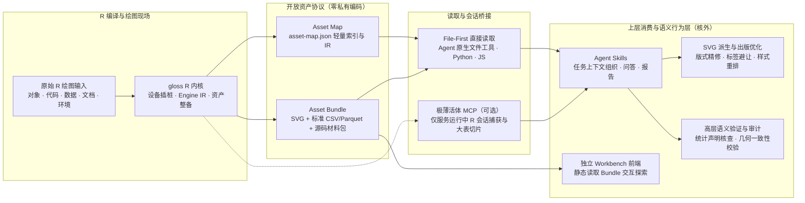

# gloss v2 架构设计：R 图形编译链的 Source Map 与资产整备内核

- **状态**：Draft（架构边界重定义）
- **日期**：2026-11-22
- **分支**：`main`
- **关系**：重定义 [`design.qmd`](design.qmd) 与 [`technical-route-and-architecture.md`](technical-route-and-architecture.md) 中的单体语义工作台边界

---

## 1. 背景与核心判断

当前 `gloss`（v1 实验态）包含 51 个 R 源文件、约 12,523 行代码、65 个导出函数。`gloss_figure` 同时承载图形底座、数据表、上下文、8 层追加语义记录、前端交互操作、8 类插件注册表与核验状态，演化成了一个包揽上下游的“全平台单体对象”。

复盘代码与评测过程，造成复杂度失控的根本原因有四点：

1. **职责边界越位**：R 会话真正不可替代的能力是观察图形设备、grob/viewport 树、绘图引擎构建态与内存数据对象；但 v1 把意图猜测（`context-assembly.R`）、Agent 阶段编排（`agent-*.R`）、语义声明存储（`core-record.R`）、MCP HTTP 路由（`mcp-interface.R`）以及 2.44 MB 的单文件前端工作台（`project-workbench.R`）全部塞进了同一个 R 包。
2. **把“强验证”误当作底层工程地基**：R 图不是野生扫描图像，而是 **`代码 + 数据 ──(引擎函数计算)──▶ 中间表示 (IR) ──(设备规范序列化)──▶ SVG`** 的确定性编程产物。v1 却把图形引擎当成不可信对象，用上千行像素回代公式（`0.5 pt` 距离门禁、`GESymbol` 符号逆向、二次重绘签名比对、无法证明完全一致就 `withheld` 扣留数据表）去做底层审查。结果遇到 `sf`、`ggrepel`、`ggbreak`、`ggtree`、`showtext` 等正常扩展行为时，要么陷入无限特判，要么直接拒绝服务。
3. **私有编码割裂外部生态**：为了追求 `identical(gl_read(f), fig)` 的 R 内存对象无损还原，v1 自创了字节洗牌二进制列（`f64le-shuffle-base64`、`index.bin`）和列式 JSON 方言，导致外部 Python/JS 工具与 Agent 无法直接读取，连仓库自己的 `bench/agent/` 都被迫另写三套开放文件导出器。
4. **过度泛化的插件机制**：把 `engine`、`rules`、`layer`、`check`、`operation`、`projection`、`context`、`stage` 8 种异质概念塞进同一套全局注册表，制造了大量无实际第三方用户的内部抽象税。

### v2 的两条第一性原理

1. **编译器 Source Map 定位**：
   `gloss` 的核心定位收缩为 **“R 图形编译链的 Source Map 生成器与图资产整备内核”**。它趁着绘图编译现场仍在 R 内存中，把序列化成裸 SVG 后会蒸发的**结构分组、面板比例尺、引擎计算中间态（IR）与输入材料关系**忠实提取并打包为跨语言开放资产。
2. **观察与验证解耦（验证是上层行为，不是底座门禁）**：
   底层只负责**忠实、中性地记录与暴露**计算产物及变换轨迹，不设像素验算门禁、不打及格/失败审判标签、不因图元数与行数不等而扣留数据。数据统计核查、图表-正文一致性审校、派生 SVG 防走样校验等“验证”需求，全部归属上层高级语义层（Agent Skills 或专用审计工具）按需执行。

---

## 2. 总体架构与职责边界



### 核内与核外职责划分

| 维度 | `gloss` R 内核（In-Core） | 核外生态（Skills / MCP / Workbench） |
| --- | --- | --- |
| **图形与几何** | 原图设备绘制、叶子 `<g>` 分组与 viewport 探针插桩、提取原始 SVG 与可寻址 SVG | SVG 排版美化、叠加上层视觉标注、浏览器端拾取与缩放渲染 |
| **数据与中间态** | 提取输入 `raw` 表、引擎构建 `built` 表、比例尺与色板字典（Scales）、图层配方（Layers）、聚类置换顺序 | 跨表业务关联推理、统计检验、聚合摘要叙述 |
| **关系表达** | 记录 `element <-> leaf <-> viewport <-> panel <-> layer/table` 的结构血缘与基数描述（`1:1`、`N:1`、`1:M`） | 语义锚点声明、跨面板叙事关联、人工或模型补充的数据绑定 |
| **上下文** | **Source Context Inventory**：收集会话内可观测环境、对象摘要、显式声明来源与轻量脚本线索 | **Task Context Packet**：按用户问题决定焦点、读取预算、披露策略与多轮检索动作 |
| **验证（Verification）** | 仅在 `manifest.json` 记录常规文件大小与 SHA-256 校验和；**不做像素回代门禁与语义审查** | 按任务需要执行统计声明核验、数据-图注交叉审计、派生 SVG 几何防篡改对比 |

---

## 3. 内核五层能力模型

`gloss` R 内核固定收敛为以下五层纯确定性能力：

| 层级 | 核心职责 | 关键产出 |
| --- | --- | --- |
| **1. 页面捕获与插桩** | 在 `svglite` 设备上完成单次绘制；保留原始 SVG 字节，同时通过 `groupGrob` / 显示列表回放与 `gloss_probe` 记录每个叶子的 `<g>` 分组和绘图期 viewport 像素框 | `original.svg`、`scene.svg`、页面尺寸、设备与绘图方法元数据 |
| **2. 引擎计算中间态（Engine IR）** | 在 `draw` 执行现场抓拍引擎已算好的规范结构，零像素反推成本 | `raw` / `built` 数据表、**Scales 视觉映射字典**（定义域 ↔ 颜色 hex / 形状 / 标签）、**Layers 配方**（`geom` / `stat` / `position` / `aes`）、分面布局表、热图行列聚类顺序（`row_order` / `column_order`） |
| **3. 结构血缘关系** | 连接设备层与引擎层：元素归属叶子、叶子归属 viewport 与 panel、图层叶子对应哪张构建表及行子集 | 结构关系表与中性的基数说明（如 `1:1` 逐行图元、`N:1` 折线/多边形组、`1:M` 复合点符号、`stat_aggregated` 统计聚合） |
| **4. 来源上下文清单** | 记录与本次绘图相关的运行时环境、R 对象与外部文件索引，严格标注来源获取方式，不混入自然语言意图猜测 | 带 `provenance_mode`（`explicit` 显式传入 / `runtime_observed` 会话观测 / `sniffed_hint` 脚本线索）的资产清单及可读性状态 |
| **5. 开放资产整备** | 从同一次捕获结果导出轻量索引地图或完整可移植资产包，全程使用跨语言通用标准格式 | `Asset Map`（JSON）与 `Asset Bundle`（标准目录或 `.zip` 归档，含 `manifest.json` 与 `omitted.json`） |

> **关键设计原则：单次捕获，载荷分层**  
> `Asset Map` 与 `Asset Bundle` 必须从同一次捕获内存态生成。不在建索引时跳过引擎构建态（`built` / `scales` / `lineage`）提取，否则后续打包将不得不重新绘图，遇到随机抖动（jitter / UMAP）或脱离原环境的对象会直接失效。两者的轻重差别仅在于**是否序列化输出全量表行明细与外部原始文件字节**。

---

## 4. 两大核心产物规范

### 4.1 索引模式：`Asset Map`（`asset-map.json`）

`Asset Map` 只包含结构化元数据、Engine IR、结构血缘摘要与材料清单，体量保持在数 KB 至数十 KB 级，供外部 Agent 首先全局了解“这张图是怎么算出来的、有哪些材料可读”。

核心顶层字段设计：

- `format` / `schema_version` / `capture_id` / `created_at`
- `page`：图形引擎名称与版本、`draw_method`（如标准 `ggplot` 或扩展包 `print.ggcut`，如实记录而不扣留数据）、图形设备与版本、页面宽高（英寸与 pt）、页数。
- `scene`：
  - `original_svg` 与 `scene_svg` 的路径、字节数、SHA-256；
  - `n_panels`、`n_leaves`、`n_elements` 及密集光栅化叶子列表。
- `ir`（引擎计算规范）：
  - `panels`：面板 ID、分面键值、设备像素边界框 `(x0, y0, x1, y1)`、数据域范围 `(x_min, x_max, y_min, y_max)`、坐标变换类型（线性 / log / 翻转 / 极坐标 / 地理投影）；
  - `layers`：图层序号、`geom`、`stat`、`position`、`aes` 映射表达式、固定参数、关联的 `raw` 与 `built` 表 ID；
  - `scales`：每个视觉通道（`colour` / `fill` / `shape` / `size` / `linetype` / `x` / `y`）绑定的字段名、离散水平或连续断点与对应的输出值（如颜色 hex 映射表）；
  - `orders`：绘图期产生的行列置换索引（如 `ComplexHeatmap` 的树状图排序与切片分组）。
- `tables`：每张表的 `id`、`role`（`raw` / `built` / `matrix` / `annotation`）、行数、列数、推断或显式指定的行键（`key`）、列类型与值域摘要。
- `lineage`：每个叶子分组（`L001...`）的 grob 名称、gtable 槽位（如 `panel`、`axis-b`、`guide-box`、`title`）、所属 `panel_id`、`layer_id`、对应的 `table_id` 以及基数关系（`cardinality`、`n_rows`、`n_elements`）。
- `sources`：代码、内存数据对象、输入数据文件、说明文档、R 会话包版本与 Git 状态。每项记录 `id`、`kind`、`provenance_mode`、`found`、`readable`、`path`、`bytes`、`sha256` 与缺失原因 `reason`。

### 4.2 打包模式：`Asset Bundle`

`Asset Bundle` 是跨语言、零私有解码器的自包含图资产目录（或压缩归档），任何 Python（`pandas` / `duckdb`）、JavaScript、R 脚本或外部 Agent 用标准库即可直接消费。

```text
<name>.gloss/
├── manifest.json            # 格式版本、capture_id、父资产派生引用、所有打包文件的字节数与 sha256
├── asset-map.json           # 完整的 Asset Map 索引、Engine IR 与结构血缘
├── omitted.json             # 未纳入本次打包或被裁剪的资产、表列、行范围及原因说明
├── assets/
│   └── original.svg         # 原始图形设备首次生成的未修改 SVG 字节（基准存档）
├── scene/
│   ├── scene.svg            # 展开 <use> 并注入稳定 <g id="L..."> 分组后的可寻址工作底图
│   ├── leaves.json          # 叶子分组详情、grob 树路径与 viewport 几何
│   ├── elements.json        # 图元级几何包围盒、标签文本、填充描边样式与所属 leaf_id
│   └── rasters/             # 可选：超密图层（如 >10^4 点）的设备光栅切片 (*.png)
├── tables/
│   ├── schema.json          # 各表精确列类型、因子水平顺序、时间时区等补充元数据
│   ├── raw.csv              # 标准 UTF-8 CSV（含显式 1-based `_row_id` 列；超大表可选 Parquet）
│   └── built_layer1.csv     # 引擎 stat/scale 计算后的数据表
└── sources/
    ├── code/                # 显式传入或捕获到的绘图脚本 / Quarto chunk 快照
    ├── docs/                # 显式传入的数据字典、实验说明、参考文献摘要等文档
    └── session.json         # R 版本、关键包版本与 Git commit 快照
```

#### 双 SVG 与派生边界约定

1. **`assets/original.svg` 与 `scene/scene.svg` 职责分离**：
   原始设备输出的 `original.svg` 可能包含 `<defs>/<use>` 复用且不含叶子 ID，作为**不可变原始基准**保存；`elements.json` 和 `leaves.json` 中的所有 ID、层级与包围盒均严格对齐到 `scene/scene.svg`（**可寻址工作底图**）。
2. **不可变派生链（Immutable Derivation）**：
   下游的 SVG 美化、Workbench 状态保存或高层语义审计记录**不回写篡改源 Bundle**，而是生成新的派生文件或子包，通过 `parent_capture_id` 和 `parent_manifest_sha256` 指向源资产包。

---

## 5. R 内核公开接口设计

将原先暴露 5 个抽象层的 65 个导出函数收缩为 **8 个左右的核心原语**：

```r
# 1. 捕获与整备入口：单次绘图提取设备场景、Engine IR、结构血缘与来源清单
cap <- gloss(
  x,
  sources = NULL,       # 可选：显式传入脚本路径、原始数据文件、数据字典或说明文档
  width = NULL,
  height = NULL,
  dense = 10000
)

# 2. 导出或落盘轻量资产索引地图（Asset Map）
map <- gl_asset_map(cap, path = NULL)

# 3. 按显式选择生成开放格式资产包（Asset Bundle）
gl_asset_bundle(
  cap,
  path = "fig-volcano.gloss",
  select = NULL,        # 指定打包哪些表、源文件或是否包含 elements 明细；NULL 默认常规全集
  rows = NULL,          # 可选：按表裁剪行范围或条件
  format = c("dir", "zip"),
  overwrite = TRUE
)

# 4. 内存态轻量读取与空间/结构切片查询（供 R 脚本与活体会话 MCP 复用）
gl_scene(cap)           # 读取 panels / leaves / elements / scales / layers
gl_tables(cap, name = NULL)
gl_sources(cap)
gl_query(cap, panel = NULL, leaf = NULL, box = NULL, table = NULL, rows = NULL)

# 5. 唯一保留的插件扩展点：绘图引擎注册（内置 ggplot / patchwork / heatmap / base / grid）
gl_register_engine(name, classes, capture_fn, ...)
```

---

## 6. 外部互操作：File-First、极薄 MCP 与 Agent Skills

### 6.1 File-First 优先于常驻服务

R 是单线程运行时。一旦 `gl_asset_map()` 或 `gl_asset_bundle()` 将资产落盘为标准 JSON / CSV / SVG 目录，外部 Coding Agent（Claude Code、Codex、Cursor、Antigravity 等）、Python 分析脚本与静态前端即可用原生文件工具直接高速读取，**无需维护脆弱的常驻 R HTTP/stdio 进程来做普通文件读取**。

### 6.2 极薄活体 R 会话 MCP（独立可选包或轻量脚本）

仅当用户处于**交互式活体 R 会话**（如 RStudio / Positron）且尚未手动导出文件，或内存数据表极大（百万行级）不宜全量落盘时，通过独立 MCP 适配层提供 4 个最小工具：

| MCP 工具 | 输入 | 职责 |
| --- | --- | --- |
| `capture_figure` | 对象名或当前活动设备、尺寸 | 在当前 R 会话触发 `gloss()` 捕获并返回 `capture_id` 与摘要 |
| `get_asset_map` | `capture_id` | 返回完整的 `Asset Map`（含 Scales、Layers、Panels 与可读资产列表） |
| `query_slice` | `capture_id` + 面板 / 空间框 / 表名 / 行范围 | 对内存态大表或密集图元做受控切片读取，避免多轮细粒度调用瀑布 |
| `create_bundle` | `capture_id` + 显式资产与表行选择 + 目标路径 | 生成标准 `Asset Bundle` 落盘，供后续 Skills 或 Workbench 消费 |

### 6.3 Agent Skills 划分（按任务目标而非 API 动作切分）

避免把底层读写步骤拆成琐碎 Skill，按**底座协议 + 高层任务工作流**组织：

1. **`gloss`（底座协议 Skill）**  
   指导 Agent 调用 R 生成或读取 `Asset Map`，理解 `scales`、`layers`、`lineage` 基数与 `provenance_mode`，根据当前用户问题自主规划并组装 **Task Context Packet**，在需要离线交付或深度加工时调用 `gl_asset_bundle()` 打包。
2. **`gloss-svg-refine`（出版级 SVG 派生优化 Skill）**  
   消费 `scene/scene.svg` + `ir.scales` + `ir.layers` + `sources`，执行标签防重叠、排版对齐、期刊配色字体规范化等派生编辑；若任务要求严格保真，由该 Skill 在高层对比派生前后数据图元的几何与文本一致性。
3. **`gloss-audit`（高层语义审校与报告 Skill）**  
   当任务明确需要“验证”时启用：结合 `tables/*.csv`、`ir` 与论文正文/图注文档，核查统计趋势描述、样本量 `n`、显著性标注、异常点解释是否有数据支撑，输出可追溯审校报告。
4. **`gloss-workbench`（交互式查看器）**  
   独立纯前端应用（`workbench/`），直接加载本地 `Asset Bundle` 目录或 `.zip` 包进行图层大纲浏览、双向数据刷选与结构检视，彻底脱离 R 包二进制构建链。

---

## 7. 现有代码资产处置图谱（12,523 行 → ~2,400 行）

为防止拆出五六个碎 R 包带来跨包联调灾难（Fragmentation Tax），采用 **“单核 R 包大瘦身 + 同仓前端独立 + 废弃过渡层直接归档删除”** 的策略：

| 当前文件 / 目录 | 当前行数 | v2 处置动作 | 说明 |
| --- | ---: | --- | --- |
| `R/core-substrate.R` | 1,629 | **精简保留（~700 行）** | 保留设备绘制、`groupGrob` / `gloss_probe` 插桩与图元几何提取；删除 `page_verdict` 重复绘图门禁与 `GESymbol` 符号逆向计数门禁 |
| `R/engine-*.R`（5 个引擎） | 1,195 | **留在核心并升级（~900 行）** | 依赖继续置于 `Suggests`，**不拆碎包**；废除 `withheld` 表扣留逻辑，补齐 `scales` 字典、`layers` 配方与热图 `orders` 提取 |
| `R/core-bind.R` + `R/core-alone.R` | 1,261 | **重写收缩（~150 行）** | 删除 `0.5 pt` 反向像素几何法庭与消融实验代码；改为直接输出引擎结构血缘（`leaf <-> layer/panel/table` 及基数描述） |
| `R/core-data.R` + `R/context-*.R` + `R/core-context.R` | 841 | **精简保留（~300 行）** | 收敛为 `Source Context Inventory`：保留会话环境、Git、显式 `sources` 与轻量脚本定位，删除 7 个外部伪上下文插件注册 |
| `R/core-bundle.R` + `R/core-codec.R` | 883 | **重写替换（~250 行）** | 彻底删除字节洗牌二进制私有编码，重写为标准 JSON + CSV/Parquet 的 `gl_asset_map()` 与 `gl_asset_bundle()` |
| `R/identify.R` + `R/hierarchy.R` | 335 | **精简合并（~150 行）** | 收敛为内存态 `gl_scene()` 与 `gl_query()` 的空间/结构切片辅助函数 |
| `R/core-plugin.R` + `R/zzz.R` | 540 | **大幅削减（~80 行）** | 废除 `rules / layer / check / operation / projection / stage` 6 类注册表，只保留极简 `engine` 分发注册 |
| `R/classify*.R` + `R/rules-*.R` | 709 | **删除** | `leaves.json` 直接暴露 grob 名、gtable 槽位名与图层 `geom` 类型，无需在核心维护硬编码角色分类规则与角色检查 |
| `R/core-record.R` + `R/core-anchor.R` + `R/core-update.R` + `R/propose.R` + `R/semantic-checks.R` + `R/core-schema.R` + `R/core-derived.R` | 1,996 | **移出核心（归档/转高层语义工具）** | 追加语义记录、多选择器重基与 6 种固定检查原语脱离 R 资产内核 |
| `R/context-assembly.R` | 600 | **移出核心（转 Agent Skill）** | 问题意图推断、焦点预算与披露规划交由外部 Agent 自主完成 |
| `R/agent-*.R` + `inst/prompts/` | 964 | **删除 / 归档** | 不再维护包内 `aisdk` 四阶段运行器 |
| `R/mcp-interface.R` | 371 | **外置为薄适配层** | 收缩为 4 个活体会话工具，作为可选脚本或独立轻量适配层维护 |
| `R/project-workbench.R` + `R/workbench-live.R` + `inst/workbench/*.gz` | 461 | **切断 R 包耦合** | `workbench/` 作为同仓独立静态前端直接读 v2 `Asset Bundle`，不再打成 2.44 MB 单文件塞进 R 包 tarball |
| `R/operations.R` + `R/project-html.R` + `R/project-accessibility.R` + `R/project-svg.R` + `inst/js/` | 646 | **删除 / 归档** | 早期过渡态浏览器投影层，职责已被独立 Workbench 与上层派生 Skill 覆盖 |

---

## 8. 迁移与落地顺序

为避免重演“在旧 `gloss_figure` 之上再叠第五层兼容外壳”的历史包袱，采用**先样板验证、再硬切内核**的四步路线：

1. **Step 0：冻结归档与真实 Agent 样板实测**
   - 对当前全栈实验分支打归档标签（`v0-monolith-archive`），保留既有评测与工作台历史可追溯性。
   - 选取仓库现有的高复杂度科研图案例（`patchwork` 临床生存曲线+森林图、火山图+富集分析、`ComplexHeatmap` 多组学热图、`sf` / 树结构图），生成 v2 目标形态的开放 `Asset Map` + `Asset Bundle` 样板，交由真实外部 Coding Agent 执行问答、SVG 精修与审校任务，实测验证字段完备性（特别是 `ir.scales`、`ir.layers` 与 `lineage` 结构）。
2. **Step 1：确定 JSON Schema 并统一开放资产格式**
   - 编写并冻结 `inst/schema/asset-map.schema.json` 与 `inst/schema/asset-bundle-manifest.schema.json`。
   - 实现无私有编码的 `gl_asset_map()` 与 `gl_asset_bundle()`，同时替换掉 `core-bundle.R` / `core-codec.R` 以及 `bench/agent/` 下分裂的材料导出脚本，使全仓只保留唯一一套开放资产格式。
3. **Step 2：内核减法手术与 Engine IR 补齐**
   - 移除底层像素回代验算（`core-bind.R`）、重复绘图门禁、`withheld` 数据扣留、6 类非引擎插件注册表及核外模块；将导出函数面收敛至核心原语。
   - 在五大内置引擎中补齐 `scales` 映射表、`layers` 配方与绘图期排序索引的标准化提取，确保此前被验证门禁拒之门外的扩展包图形全部顺畅导出。
4. **Step 3：外置消费端对齐与文档翻新**
   - 更新 `workbench/` 前端解码器，直接读取 v2 标准目录/压缩包（移除私有二进制解码负担）。
   - 编写 `gloss` 底座协议 Skill 与可选的活体 R 会话 MCP 薄适配层，按新边界重绘架构与材料工作流图，并新增 ADR 记录本次架构重定义。
