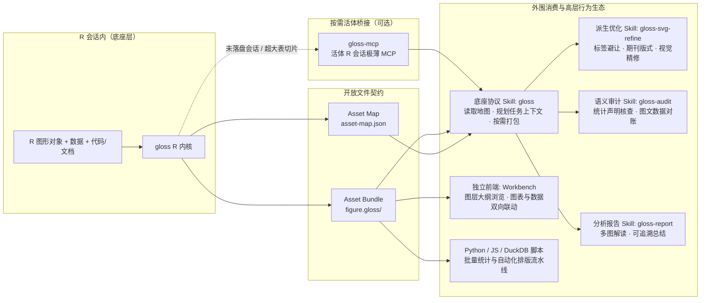

# gloss 架构设计

**R 图形编译现场的 Source Map 与开放图资产整备内核**

---

## 1. 做什么

在 R 语言中，一张科研或分析图表是由代码、原始数据、图形引擎计算与图形设备渲染共同生成的。但当它最终导出为一张普通 SVG 或 PNG 图片时，绘图过程中的幕后结构——哪个图元来自哪张表、哪种颜色代表什么分组、统计变换算出了什么中间值、热图聚类重排成了什么顺序——会全部蒸发，只剩下扁平的几何线条和文字。

`gloss` 是一个轻量的 R 核心包。它在**绘图仍在 R 内存与图形设备中执行的瞬间**介入，完成两件事：

1. **现场抓拍与结构打标（Source Map 生成）**：保留原始设备输出的 SVG，同时生成一份注入了稳定图层分组 ID 的可寻址 SVG，并将图形引擎的计算中间态（数据表、比例尺色板字典、图层配方、面板坐标系、排序索引）与运行时来源信息完整记录下来。
2. **开放格式资产整备（Asset Packaging）**：将同一次抓拍到的结构与材料，按需输出为两种跨语言通用的标准文件产物：
   - **`Asset Map`（`asset-map.json`）**：几十 KB 级的轻量全局目录与计算摘要，供外部 AI 或工具快速了解“这张图是怎么画出来的、有哪些材料可用”。
   - **`Asset Bundle`（`.gloss/` 目录或 `.zip`）**：包含双版本 SVG、标准 CSV/Parquet 数据表、Engine IR 与源码文档的自包含资产包，脱离 R 环境也能在任何地方直接读取和加工。

`gloss` 本身不内置大模型调用、不猜测用户提问意图、不负责图表美化或网页界面渲染，只专注于把 R 绘图现场变成干净、标准的开放资产。

---

## 2. 为什么这么做

整套架构建立在三条核心设计理由之上：

### 2.1 在编译现场提取中间态，而不是对着成品图反推

R 绘图的本质是一条确定性的编译流水线：

```text
原始代码与数据 ──(图形引擎计算)──▶ 引擎中间表示 (Engine IR) ──(图形设备序列化)──▶ SVG 画面
```

图形引擎（如 `ggplot2`、`patchwork`、`ComplexHeatmap`、`base`、`grid`）在绘制时已经算好了所有的分面布局、统计聚合结果、离散/连续色板映射以及树状图排序。只有活着的 R 会话与图形设备能够零成本、零误差地直接读取这些内存结构；一旦离开 R 会话再靠视觉或脚本从 SVG 反推，既脆弱又丢失统计语义。因此，**R 内核只做且垄断“现场提取与结构插桩”这一件不可替代的事**。

### 2.2 观察与验证解耦：底层如实记录，上层按需验证

在编程出图的场景下，数据和图形本就是确定性函数、计算规则与设备格式规范下的产物。因此：

- **内核扮演“行车记录仪”，而非“安检门禁”**：底层只负责忠实、中性地记录“引擎算出了什么表、生成了什么图层、图元与数据行是什么对应基数（一对一、多行合成一条折线、一行展开为复合符号、统计聚合等）”，不设像素回代门槛，不因扩展包（如 `ggrepel`、`sf`、`ggbreak`、`ggtree`）的特殊绘制方式而报错或隐瞒数据。
- **验证是一种高层语义行为**：是否需要核查“图注写的显著性与原始数据是否一致”，或者“AI 优化排版后的派生 SVG 是否意外挪动了数据点坐标”，取决于具体的下游任务。这类验证逻辑由上层审计工具或专用 Skill 按需执行，不固化在资产底座里。

### 2.3 文件优先（File-First）与零私有编码

图资产的消费者遍布外部 AI 编程助手、Python 分析脚本、浏览器前端与自动化排版流水线。因此：

- **全部采用通用开放格式**：图形存标准 UTF-8 SVG，元数据与结构关系存标准 JSON，数据表存标准 CSV（超大表可选 Parquet）并附带显式类型声明。不发明私有二进制编码，也不追求将资产包无损反序列化回复杂的 R 内存对象。
- **摆脱常驻 R 进程依赖**：资产一旦落盘，任何外部工具用各自语言的标准库即可直接读取，无需在后台维持脆弱的单线程 R 服务进程来做普通文件访问。

---

## 3. 核心概念速查

| 核心概念 | 直观含义 | 在架构中的作用 |
| --- | --- | --- |
| **Source Map** | 图形的“幕后源码地图” | 连接最终 SVG 上的视觉元素与背后的图层、面板、数据表及绘图代码。 |
| **Engine IR（引擎中间态）** | 绘图引擎算好的“半成品草稿” | 保存 `built` 计算表、`scales` 色板/通道映射字典、`layers` 图层配方、面板坐标域与聚类排序索引。 |
| **Leaf `<g>` / Viewport** | 图层零件组与画布坐标框 | 绘图期通过轻量探针为每组图形零件打上稳定 ID（`L001...`）并记录像素边界框，使 SVG 具备精确可寻址性。 |
| **Lineage（结构血缘）** | 图元到数据的“生成族谱” | 中性记录元素 → 叶子组 → 面板 → 图层与数据表的归属关系及基数（`1:1`、`N:1`、`1:M`、`stat_aggregated`）。 |
| **Source Inventory** | 原始材料与环境清单 | 记录本次绘图涉及的对象、脚本、数据文件、说明文档与包版本，并明确区分来源方式（显式传入 / 会话观测 / 脚本线索）。 |
| **`Asset Map`** | 轻便“全局目录单” | 数十 KB 的 `asset-map.json`，让 AI 先低成本掌握全局结构与可用材料，再决定下一步读什么。 |
| **`Asset Bundle`** | 自包含“可移植资产包” | 收纳双版本 SVG、数据表切片、Engine IR 与源码文档的标准目录或 `.zip` 包，可离线流转与跨工具消费。 |

---

## 4. 内核怎么做

### 4.1 单次捕获与五层整备流水线

`gloss` 在一次图形绘制过程中顺序完成五层信息整备，**`Asset Map` 与 `Asset Bundle` 共享同一次捕获内存态**，绝不为打包资产而触发二次重绘（从而天然兼容带随机抖动如 jitter / UMAP 的图形）：

1. **设备捕获与分组插桩（Capture & Instrumentation）**  
   在 `svglite` 设备上执行绘图，保存未经改动的 `original.svg`；同时通过图形组包裹（`groupGrob` / 显示列表分步回放）与绘图期探针（`probe`）展开 `<use>` 复用、注入稳定叶子 `<g id="L...">` 分组，并记录每个 viewport 在设备上的精确像素框与比例尺范围，生成可寻址的 `scene.svg`。
2. **引擎中间态提取（Engine IR Extraction）**  
   针对内置支持的五大绘图体系（`ggplot2`、`patchwork`、`ComplexHeatmap`、`base`、`grid`）及注册扩展引擎，在绘制完成瞬间提取：
   - 输入 `raw` 表与引擎统计变换后的 `built` 表；
   - **视觉映射字典（`scales`）**：每个视觉通道（颜色、填充、形状、大小、线型、坐标轴）绑定的变量名、断点标签及定义域到视觉值（如分类名 ↔ Hex 色值）的映射表；
   - **图层配方（`layers`）**：`geom`、`stat`、`position`、`aes` 映射表达式与固定参数；
   - **面板与排序（`panels` & `orders`）**：分面布局矩阵、坐标系类型（线性、对数、翻转、极坐标、地理投影）以及绘图期才生成的行列置换索引（如热图聚类顺序）。
3. **结构血缘构建（Structural Lineage）**  
   建立 `element <-> leaf <-> viewport <-> panel <-> layer/table` 的结构连接表，标注每组叶子的 grob 名称、布局槽位（如 `panel`、`axis`、`guide-box`、`title`）以及行到图元的基数关系。
4. **来源清单盘点（Source Context Inventory）**  
   汇总与当前图关联的上下文来源，并为每条来源标注获取方式（`provenance_mode`）：
   - `explicit`：调用方通过 `gloss(x, sources = ...)` 显式传入的脚本、原始数据文件、数据字典或方法文档；
   - `runtime_observed`：当前 R 会话直接观测到的输入对象结构、包版本、工作目录与 Git 提交信息；
   - `sniffed_hint`：从当前执行环境（如 Quarto/knitr 代码块或命令行脚本路径）自动识别到的轻量代码线索。
5. **分层序列化输出（Layered Serialization）**  
   - 导出 **`Asset Map`**：仅序列化页面信息、Engine IR、结构血缘摘要、数据表列概览与来源清单指针。
   - 导出 **`Asset Bundle`**：按默认全集或调用方显式筛选的表、列、行范围与源文件写出完整目录/压缩包，未纳入或被裁剪的内容统一记录在 `omitted.json` 中。

### 4.2 `Asset Map`（`asset-map.json`）结构

```json
{
  "format": "gloss-asset-map",
  "schema_version": "1.0.0",
  "capture_id": "sha256:...",
  "created_at": "2026-11-22T10:00:00Z",
  "page": {
    "engine": "ggplot",
    "engine_version": "4.0.3",
    "draw_method": "ggplot_gtable",
    "device": "svglite 2.2.2",
    "width_in": 7.0,
    "height_in": 5.0,
    "width_pt": 504.0,
    "height_pt": 360.0,
    "pages": 1
  },
  "scene": {
    "original_svg": { "path": "assets/original.svg", "bytes": 18420, "sha256": "..." },
    "scene_svg": { "path": "scene/scene.svg", "bytes": 19680, "sha256": "..." },
    "n_panels": 2,
    "n_leaves": 18,
    "n_elements": 412,
    "dense_leaves": []
  },
  "ir": {
    "panels": [
      {
        "panel_id": "P1",
        "facet_vars": { "arm": "Treatment" },
        "bbox_pt": [42.5, 28.0, 248.0, 318.0],
        "x_domain": [0.0, 24.0],
        "y_domain": [0.0, 1.0],
        "coord": "CoordCartesian",
        "flipped": false
      }
    ],
    "layers": [
      {
        "layer_id": 1,
        "geom": "GeomPoint",
        "stat": "StatIdentity",
        "position": "PositionIdentity",
        "aes": { "x": "time", "y": "survival", "colour": "cohort" },
        "raw_table": "raw",
        "built_table": "built_layer1"
      }
    ],
    "scales": [
      {
        "aesthetic": "colour",
        "field": "cohort",
        "scale_type": "discrete",
        "map": [
          { "domain": "Cohort A", "value": "#0072B2", "label": "Cohort A (n=48)" },
          { "domain": "Cohort B", "value": "#D55E00", "label": "Cohort B (n=52)" }
        ]
      }
    ],
    "orders": {}
  },
  "tables": [
    {
      "table_id": "raw",
      "role": "raw",
      "nrow": 100,
      "ncol": 6,
      "key": ["patient_id"],
      "path": "tables/raw.csv",
      "columns": [
        { "name": "patient_id", "type": "character", "distinct": 100 },
        { "name": "survival", "type": "double", "min": 0.12, "max": 0.99 }
      ]
    }
  ],
  "lineage": [
    {
      "leaf_id": "L004",
      "grob_name": "geom_point.points.42",
      "layout_slot": "panel-1-1",
      "panel_id": "P1",
      "layer_id": 1,
      "table_id": "built_layer1",
      "cardinality": "1:1",
      "n_rows": 50,
      "n_elements": 50
    }
  ],
  "sources": [
    {
      "source_id": "plot_script",
      "kind": "code",
      "provenance_mode": "explicit",
      "found": true,
      "readable": true,
      "path": "sources/code/plot_km.R",
      "bytes": 1480,
      "sha256": "..."
    }
  ]
}
```

### 4.3 `Asset Bundle`（`.gloss/`）目录结构

```text
figure.gloss/
├── manifest.json            # 包格式版本、capture_id、父资产引用（若有）、全量文件字节数与 sha256
├── asset-map.json           # 完整的 Asset Map 索引、Engine IR 与结构血缘
├── omitted.json             # 未选入打包或被行/列裁剪的资产清单及原因说明
├── assets/
│   └── original.svg         # 图形设备直接生成的原始未改动 SVG 字节（基准存档）
├── scene/
│   ├── scene.svg            # 注入稳定 <g id="L..."> 分组后的可寻址 SVG（与 elements 一一对应）
│   ├── leaves.json          # 叶子分组详情、grob 路径与 viewport 像素框
│   ├── elements.json        # 图元级几何包围盒、文本内容、样式属性与所属 leaf_id
│   └── rasters/             # 可选：超密图层（如 >10^4 点）的设备光栅切片 (*.png)
├── tables/
│   ├── schema.json          # 各表字段类型、因子水平顺序、时区等精确定义
│   ├── raw.csv              # 标准 UTF-8 CSV（首列带显式 1-based `_row_id`；超大表可选 Parquet）
│   └── built_layer1.csv     # 引擎计算后的图层数据表
└── sources/
    ├── code/                # 绘图脚本或代码块文本快照
    ├── docs/                # 关联的数据字典、实验设计说明或图注草稿
    └── session.json         # R 版本、已加载包版本与 Git 状态元数据
```

> **双 SVG 协同约定**  
> `assets/original.svg` 保存设备原始输出，作为不可变对照基准；`scene/scene.svg` 则是展开复用符号并挂好稳定分组 ID 的工作底图，`leaves.json` 与 `elements.json` 中的所有标识符和几何位置均严格对齐 `scene/scene.svg`。任何下游工具产出的优化版 SVG 或标注结果均作为**新派生资产**独立存储，通过 `parent_manifest_sha256` 指向源包，绝不原地覆写源包文件。

### 4.4 R 内核模块与公开接口

R 包内部保持紧凑扁平，仅分六个职责单一的模块：

- `R/capture.R`：设备管理、图形组包裹、绘图期 viewport 探针与 SVG 解析。
- `R/engine-*.R`：`ggplot`、`patchwork`、`heatmap`、`base`、`grid` 五大内置引擎适配（依赖置于 `Suggests`）与扩展引擎注册表。
- `R/ir-lineage.R`：比例尺字典、图层配方、面板域与叶子结构血缘构建。
- `R/sources.R`：运行时环境、显式来源与轻量代码线索盘点。
- `R/package-assets.R`：`Asset Map` 与 `Asset Bundle` 开放格式序列化及 `manifest.json` / `omitted.json` 生成。
- `R/query.R`：内存态捕获对象的轻量检视与空间/表格切片查询。

对外仅导出 **8 个核心函数**：

```r
# 1. 绘图现场抓拍：一次绘制提取双 SVG、Engine IR、结构血缘与来源清单
cap <- gloss(
  x,
  sources = NULL,       # 可选：显式传入关联代码文件、原始数据路径或说明文档
  width = NULL,
  height = NULL,
  dense = 10000
)

# 2. 获取或写出轻量索引地图（Asset Map）
map <- gl_asset_map(cap, path = NULL)

# 3. 按需选择材料生成开放资产包（Asset Bundle）
gl_asset_bundle(
  cap,
  path = "figure.gloss",
  select = NULL,        # 指定要打包的表、源文件或图元明细；NULL 默认打包完整常规集
  rows = NULL,          # 可选：按表裁剪行范围或过滤条件
  format = c("dir", "zip"),
  overwrite = TRUE
)

# 4. 内存态轻量读取与条件切片查询
gl_scene(cap)
gl_tables(cap, name = NULL)
gl_sources(cap)
gl_query(cap, panel = NULL, leaf = NULL, box = NULL, table = NULL, rows = NULL)

# 5. 第三方绘图引擎扩展注册
gl_register_engine(name, classes, capture_fn, ...)
```

---

## 5. 配合的生态是什么

`gloss` R 内核以 `Asset Map` 和 `Asset Bundle` 为契约边界，与外围四类独立组件组成完整生态：



### 5.1 Agent Skills 家族（智能理解、派生与高层验证层）

外部 AI 编程助手（Claude Code、Codex、Cursor、Antigravity 等）通过模块化的 `SKILL.md` 接入：

- **`gloss`（底座协议 Skill）**：所有图表任务的公共入口协议。指导 AI 如何触发 R 抓拍、如何解读 `Asset Map` 中的比例尺字典与结构血缘、如何根据用户的具体问题自主挑选所需材料组装 **Task Context Packet（任务上下文包）**，以及何时调用 `gl_asset_bundle()` 导出离线包。
- **`gloss-svg-refine`（出版级 SVG 派生精修 Skill）**：基于 `scene/scene.svg` 的清晰 `<g>` 图层结构与 `ir.scales` / `ir.layers` 规范，执行重叠文字避让、图例重排、字体字号规范化、期刊色板替换与重点高亮注释，输出结构干净的出版级派生 SVG。
- **`gloss-audit`（高层语义验证与审稿对账 Skill）**：承接所有“验证”类需求。结合 `tables/*.csv`、`ir`、绘图代码与论文正文/图注，编写可复现脚本核查样本量 `n`、分组均值/趋势、显著性标记、异常点归因或检查派生 SVG 是否保持了数据几何一致性。
- **`gloss-report`（图表解读与报告生成 Skill）**：面向多面板复合图或整套项目图表，整合数据证据与业务背景文档生成结构化解读报告。

### 5.2 `gloss-mcp`（极薄活体 R 会话桥接层）

当资产已经落盘为文件时，外部生态直接读盘，不需要 MCP。只有在**用户正开着交互式 R 会话（如 RStudio / Positron）边画边聊尚未落盘**，或**内存数据表高达百万行不宜全盘导出**时，才挂载独立的极薄 MCP 适配层，仅提供 4 个工具：

| 工具名 | 作用 |
| --- | --- |
| `capture_figure` | 对当前 R 会话中的指定绘图对象或活动图形设备执行 `gloss()` 抓拍，返回 `capture_id`。 |
| `get_asset_map` | 读取该次抓拍的完整 `Asset Map`（Engine IR、表结构概览、血缘与来源清单）。 |
| `query_slice` | 调用 `gl_query()` 按面板、像素区域、叶子 ID 或过滤条件从内存大表中精准切出一小块明细数据。 |
| `create_bundle` | 按 AI 明确选定的表、列、行范围与源文件清单调用 `gl_asset_bundle()` 将资产包落盘。 |

### 5.3 独立前端工作台（`Workbench`）

纯静态浏览器单页应用（独立于 R 包构建与发布）。用户直接拖入或打开任意 `.gloss` 目录/压缩包，即可浏览图形结构大纲树、查看 `raw` / `built` 数据表、点击图元高亮对应数据行（或点击表格筛选图上分组）、对照 `original.svg` 与派生修改效果。

### 5.4 通用数据与排版工具链

由于 `Asset Bundle` 全部由标准 JSON、CSV/Parquet 与 SVG 构成，Python（`pandas` / `polars` / `lxml`）、DuckDB SQL、Node.js 排版脚本和期刊自动化生产流水线无需安装 R 或任何专用 SDK 即可直接批处理。

---

## 6. 生态怎么配合：四条标准协作工作流

### 工作流一：图表问答与深度溯源（离线 File-First 模式）

1. **R 端整备**：分析脚本运行 `cap <- gloss(p, sources = list(code = "fig2.R", docs = "methods.md"))` 并写出 `gl_asset_bundle(cap, "fig2.gloss")`。
2. **目录先行**：外部 AI 激活 `gloss` 底座 Skill，**第一步只读 `fig2.gloss/asset-map.json`**（几十 KB），立即掌握子图面板范围、颜色对应的实验组别、图层配方与数据表概览，避免一次性把大表和整棵 SVG DOM 塞进上下文窗口。
3. **按需深读**：AI 根据用户提问（例如“为什么右上角有两个离群样本？”），自主决定只用标准 CSV/SQL 工具读取 `tables/built_layer1.csv` 中满足坐标条件的几行，再结合 `tables/raw.csv` 的 `_row_id` 查出对应样本编号并翻阅 `sources/docs/methods.md`。
4. **可追溯作答**：AI 给出附带精确样本 ID、原始数值、面板位置与叶子 ID（如 `L004`）的分析回答。

### 工作流二：出版级 SVG 排版精修（`gloss` + `gloss-svg-refine`）

1. **结构定位**：`gloss-svg-refine` 读取 `asset-map.json` 的 `lineage` 与 `ir.scales`，精确区分 `scene/scene.svg` 中哪些 `<g id="L...">` 是不可随意移动的数据散点/曲线图层，哪些是可调整版式的坐标轴标题、图例框（`guide-box`）或重叠文本标签。
2. **受控派生**：Skill 在保持数据面板坐标映射不变的前提下，重写或微调文字避让引线、字体族、字号层级、线条粗细与色盲友好色板（依据 `ir.scales` 的映射字典同步更新图例与图层颜色），输出新文件 `derived/fig2-pub.svg`。
3. **血缘留痕与可选核验**：写出派生描述文件记录 `parent_manifest_sha256` 与修改说明；若用户要求严格防走样，再调用审计脚本比对 `fig2-pub.svg` 与 `scene/scene.svg` 中数据图元的几何中心与文本内容完全未变。

### 工作流三：审稿级图文数据核查（`gloss` + `gloss-audit`）

1. **材料汇集**：将论文初稿段落/图注与图表对应的 `fig2.gloss/` 一并交给激活了 `gloss-audit` Skill 的 AI。
2. **高层编程核验**：AI 阅读图注中的每一项定量声明（如“治疗组中位无进展生存期较对照组延长 4.2 个月，样本量 `n = 128`，各亚组风险比均小于 1”），直接对 `tables/raw.csv` 和 `tables/built_layer*.csv` 运行 Python/R 检验脚本逐条核对。
3. **输出对账报告**：准确列出完全吻合的声明、存在四舍五入偏差的数值，或个别不满足总体结论的亚组（如 10 个亚组中有 2 个置信区间跨过 1），供作者修改正文或图注。

### 工作流四：交互式 R 会话实时协作与可视化探索（活体模式）

1. **会话内即席捕获**：用户在 RStudio / Positron 中刚画出一张包含 50 万个单细胞的 UMAP 图，无需手动写导出代码，直接在对话中提问；AI 通过 `gloss-mcp` 调用 `capture_figure` 与 `get_asset_map`。
2. **轻量内存切片**：发现数据量巨大且密集点图层已生成光栅索引，AI 不导出全表，而是调用 `query_slice` 只切取目标聚类区域内的汇总统计与代表性行。
3. **无缝转交 Workbench**：当用户希望亲自交互查看各个基因模块与细胞亚群时，AI 调用 `create_bundle` 将选定子集打包为 `.gloss` 目录，在浏览器中用独立 `Workbench` 打开，实现图层开关、分组刷选与细节巡检。
