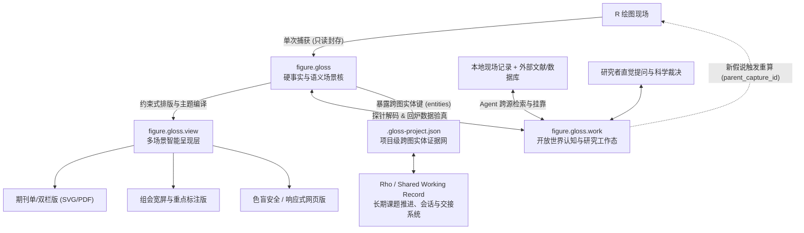

# gloss 外围生态与价值延展设计：结晶核、智能呈现与共享研究记录

> **核心命题**：核必须极窄、极硬、稳定、零猜测；出口必须宽、活、可连接、可演化。  
> **关联文档**：[`architecture.md`](architecture.md) · [`what-and-why.md`](what-and-why.md) · [`kernel-upgrade-plan.md`](kernel-upgrade-plan.md)

---

## 1. 价值升维：为什么 gloss 不只是一个“高级看图或修图工具”？

如果只从单张图表的导出痛点出发，很容易把 `gloss` 理解成一个“能让图表点选查数、核对图注、微调排版的辅助插件”。这些能力都真实有用，但如果止步于此，视野仍然被困在**单张图表的边框之内**。

在 Agent 成为通用信息搜集与操作接口的时代，`gloss` 封存下来的“图形 + 数据 + 统计过程 + 来源”硬上下文，在包外生态中会释放出**一上一下两股更高维度的核心价值**：

1. **向上连接开放世界（科学认知的“结晶核”）**  
   真实研究里的因果解释往往不在数据表内部，而散落在实验记录、临床备注、代码历史、最新文献与领域数据库等“数据之外的软上下文”中。Agent 擅长跨源搜集这些信息，但缺乏硬坐标时极易泛化与过度联想。  
   图表天然负责显影数据中的反常与张力，`gloss` 则把这个视觉反常翻译成**精确的样本/基因实体身份、计算边界与统计偏离度**——为 Agent 提供精准的向外检索探针，并要求外部搜集到的任何假说必须**回到硬数据中挂靠与验真**。

2. **向下解放视觉表达（约束式智能呈现底座）**  
   传统科研绘图长期卡在“改 R 代码可重复但调版面极慢”与“进矢量软件手改灵活但极易破坏数据关系”的夹缝中。  
   因为 `gloss` 同时知道**“图表达了什么事实”**与**“图由哪些语义组件和几何约束构成”**，外围呈现引擎就可以在锁死底层数据事实的前提下，自动完成长标签换行避让、全局语义换色、多面板重排，并从同一份事实核无损编译出期刊版、汇报版、网页交互版与色盲安全版。

### 三层标准定位表述

- **技术定位（面向协议与开发者）**：`gloss` 是一种面向科学图表的证据与场景协议，将图面几何、语义组件、数据行与跨图实体、统计过程及运行环境封存为稳定、可查询、可验证的开放对象。
- **产品定位（面向研究者与工具链）**：`gloss` 让事实保持硬，让表达保持活——使静态图表既能回溯数据与核验结论，又能安全地自动排版、美化与多形态交付。
- **战略定位（面向科研认知生态）**：`gloss` 是开放世界科学认知网络的硬事实锚点层，让视觉直觉获得精确地址，让外部现场记录与公共知识精准挂靠在数据实体上，并始终回到硬数据中验真。

---

## 2. 外围三元文件架构：`.gloss` · `.gloss.view` · `.gloss.work`

为防止“呈现美化”或“Agent 假说推演”污染底层数据事实，外围生态围绕单个图表对象拆分为三个职责正交的目录/文件单元，并在项目根目录通过轻量跨图索引串联：



| 单元 | 可变性 | 核心职责 | 严禁混入的内容 |
| :--- | :---: | :--- | :--- |
| **`figure.gloss`** | **只读不可变**<br/>（SHA-256 锁定） | 保存原始与编号底图、两级数据表与丢行漏斗、跨图实体键、标度令牌、面板依附拓扑、三级编辑契约及代码环境来源。 | 任何未经编译现场验证的模型猜测、后期手工涂改或主观讨论。 |
| **`figure.gloss.view`** | **可再生 / 多实例** | 保存面向不同交付场景的视图声明（主题、版面尺寸、排版操作）及编译产出的派生图形与几何防走样验证回执。 | 篡改数据值、挪动锁死坐标、偷改刻度数字或脱离源包校验码的裸文件。 |
| **`figure.gloss.work`** | **持续演进生长** | 保存围绕具体图元与数据实体挂靠的现场记录、外部文献、候选假说、数据回验结果、人类裁决及下一步验证指针。 | 不带来源、时间戳与证据状态（支持/反驳/待验）的无主信息堆积。 |

---

## 3. 支柱一（向下解放表达）：`.gloss.view` 智能呈现引擎设计

### 3.1 三层图形表达解耦

外围呈现引擎不再把 SVG 当作一串脆弱的 XML 字符串硬改，而是基于内核提供的结构按三层运作：

1. **硬事实层（不可动摇）**：数据数值、行级与实体映射、统计汇总结果、坐标变换关系、分组归属、聚类树拓扑、过滤与裁剪记录。
2. **语义场景层（关系与约束）**：组件角色（数据标记、数据标签、引线、坐标轴、分面条、图例）、组件依附关系（哪个轴挂在哪个面板的哪条边）、纵横比锁（自由伸缩 vs 固定高宽比）、逻辑文本块与目标样本锚点、语义颜色令牌。
3. **智能呈现层（自适应求解）**：根据目标画布尺寸与风格模板，在约束范围内重算排版、换色、换行、避让与标注，输出最终交付文件。

### 3.2 三级安全编辑契约（Safe Edit Contract）

任何自动化排版器或 Agent 执行修改前，必须遵守内核导出的三级属性边界：

- **默认锁定（`locked`）**：数据坐标映射、样本与分组身份、刻度与数据标签文本真值、统计值、聚类连接关系——普通排版指令一旦触碰直接拒绝。
- **默认可编辑（`editable`）**：字体族、字号层级、字重、语义配色盘、点半径、线宽、透明度、面板间距、图例停靠位（上/下/右/内嵌）、长标签自动换行、重叠文字平移避让、引线路径重连、刻度文字旋转角。
- **需显式授权（`gated`）**：收窄坐标轴范围、隐藏特定异常样本、更改误差棒统计口径、重排热图顺序、更改颜色代表的分组定义——此类操作会改变证据解释，必须由研究者显式确认，原则上优先转入修改 R 代码重新生成新版 `.gloss`（串联 `parent_capture_id`），或在衍生图注中强制披露。

### 3.3 五类核心自动化呈现能力

1. **自动文字布局与防碰撞避让**：依托逻辑文本块（`text_block_id`）、真实测量字宽与目标数据锚点（`target_anchor_pt`），自动处理长轴标换行、刻度拥挤旋转、离散数据标签避让数据点与面板边框，并在标签推远时自动补画或重连引线。
2. **全局语义配色与多图例同步**：按标度令牌（`scale_id + domain`）替换色盘（如一键切换色盲友好配色或黑白印刷灰阶+线型组合），保证主图散点、半透明箱体/置信带、图例色块、分面标题背景与连续色阶条严格同步，绝不误改无关参考线。
3. **多面板响应式布局重排**：依托面板纵横比锁与周边组件依附拓扑（`attached_to`），在单栏（如 89mm）与双栏（如 183mm）或 16:9 汇报画布之间重新分配面板网格、间距与合并图例位置，坐标轴与分面条随面板刚性联动。
4. **出版与汇报主题系统（Theme Profiles）**：提供声明式主题预设（`nature-single`、`nature-double`、`science`、`thesis`、`slide-deck`、`web-interactive`），实现“一次 R 计算，多模板一致性输出”。
5. **数据驱动的重点强调与注释**：根据选定的样本实体 ID 或统计阈值，自动生成局部压暗高亮、趋势交叉点标注、显著性括号或局部放大插图（Inset）。

---

## 4. 支柱二（向上连接世界）：`.gloss.work`、四元信息网与跨图认知体系

### 4.1 为什么是“图 + 硬上下文 + Agent + 人”的四元协同？

单靠任何单一载体都存在结构性盲区：
- **普通图片**：一眼看清反常结构，但没有数据地址与计算来源；
- **原始大表**：数值和实体完整，但平铺无重点，不知道哪里值得追问；
- **裸 Agent 检索**：能跨文献与记录搜集海量背景，但没有硬坐标，极易停留在泛泛而谈的联想；
- **`.gloss` 结晶核**：把“视觉反常位点 ↔ 具体实体 ID ↔ 统计过程与过滤边界”焊接在一起，但本身不替人做因果判断。

四者组合后形成的标准研究闭环如下：

1. **凝视点火（人 + 图）**：研究者凭直觉圈出图面反常区域（例如给药组中 4 个完全无响应的样本点，或热图中反常分离的一个亚簇）。
2. **晶核解码（`.gloss` 探针生成）**：立即将像素选区翻译为结构化探针——哪几个样本 ID、对应哪些表行、属于哪个批次、偏离同组均值多少倍标准差、成图前与成图时是否有同类样本被过滤或裁剪、使用了什么统计模型与代码版本。
3. **三路取证与回炉验真（Agent ↔ 外部世界 ↔ 硬数据）**：
   - **查账本内真相**：检查这批样本在本图其他未映射列或同项目其他 `.gloss` 图表中是否同步异常；
   - **查本地私有现场**：带着样本 ID 与批次号检索实验记录本、质控表格、临床随访备注与代码提交历史（如排查是否存在解冻延迟、合并用药或阈值变更）；
   - **查公共领域知识**：带着特征基因集与表型约束检索文献、通路库与公开队列，收集候选机制；
   - **回炉硬数据验真（核心纪律）**：Agent 绝不能把文献猜想直接当结论输出，必须回头查询 `.gloss` 表格验证该机制所需的数据前提是否成立（例如：“文献提示旁路基因 X 高表达导致耐受 → 回查本课题表达表发现这 4 例的基因 X 确实高出同组 4.2 倍，而批次指标全部正常”）。
4. **裁决沉淀与晶核演化（人 → `.gloss.work` → 下一张 `.gloss`）**：研究者审阅证据链，做出接受、排除或搁置判断，将外部证据与判断挂靠在该图元与实体地址上；若需进一步验证，驱动修改 R 脚本生成分层验证新图（新 `.gloss` 晶核），形成连续可追溯的探索链。

### 4.2 严守认识论边界：`.gloss.work` 的四层对象规范

为防止 Agent 的猜测污染科学记录，`.gloss.work/` 内部严格区分四类信息层级，所有外部挂靠条目强制携带**来源、时间、提取方式、锚定地址与证据状态**：

```text
figure.gloss.work/
├── workspace.json       # 绑定源包 capture_id 与 manifest_sha256
├── focus.json           # 当前人机共享的选区探针与组内偏离摘要
├── evidence.json        # 外部证据库（实验记录、临床备注、文献、数据库条目）
├── hypotheses.json      # 候选解释及其回炉硬数据核验回执（supports / refutes / unmeasured）
└── decisions.json       # 研究者科学裁决、排除理由及派生新图 capture_id 指针
```

- **生成事实（在 `.gloss` 内）**：“这四个点来自样本 S047–S050，按公式 F 计算生成。”
- **外部证据（`evidence.json`）**：“实验日志 `lab_2026_11.md#L42` 记录批次 B 正常；文献 `PMID:...` 报道旁路基因 X 介导耐药。”
- **候选假说与验真（`hypotheses.json`）**：“假说 H1（批次效应）已被跨图质控数据证伪；假说 H2（基因 X 旁路激活）获原始表第 128–131 行数据支持，待湿实验确认。”
- **科学判断（`decisions.json`）**：“研究者确认排除 H1，采纳 H2 作为下一步分层验证方向，触发生成 `fig2b_stratified.gloss`。”

### 4.3 跨图实体证据网与 `Rho`（Shared Working Record）的分工边界

当一个课题包含十几张 `.gloss` 图表时，外围生态通过它们暴露的共同实体键（`patient_id`、`sample_id`、`gene_symbol`、`batch_id`）自动构建项目级轻量索引（`.gloss-project.json` 或 DuckDB 视图），实现跨图秒级穿透。

同时，`gloss` 生态与上层 **Rho / Shared Working Record（共享工作记录系统）** 保持清晰职责切分，绝不越界做成臃肿的全能平台：

| 层次 | 负责什么 | 不负责什么 |
| :--- | :--- | :--- |
| **`.gloss` 核心包** | 单张图表的硬上下文封存、语义场景与可寻址事实坐标 | 不存软笔记、不做排版求解、不管项目任务流 |
| **`.gloss.view`** | 单张图表的多模板智能排版、美化与防走样导出 | 不修改底层数据与统计结论 |
| **`.gloss.work` + 跨图索引** | 围绕图表与跨图实体挂靠证据、回炉验真与沉淀局部判断 | 不替代全局文献管理软件、电子实验记录本（ELN）或医院数据仓库 |
| **Investigation Canvas（前端工作台）** | 以图为视觉入口，同屏汇流“账本内数据 + 本地现场线索 + 外部文献证据 + 视图预览” | 不承担长期后台任务调度与多角色权限治理 |
| **Rho / Shared Working Record** | 管理课题级长期目标、多轮 Agent 会话、研究分支、团队权限、跨阶段决策与项目交接 | 不深入解析 R 图形设备与底层 SVG 几何结构（直接把 `.gloss` 三件套作为一等公民对象引用） |

---

## 5. 最值得优先打穿的两个标杆闭环（MVP Hero Loops）

不追求一次性铺开所有外围大前端，优先用两个极小但完整的闭环验证整套设计的真实威力：

### 闭环一：认知溯源闭环（验证“结晶核 + 回炉验真”）
- **输入**：一组关联课题材料（主结果散点/生存图 `.gloss` + 质控/表达热图 `.gloss` + 一份模拟真实瑕疵的实验记录 Markdown + 几篇候选机制文献摘要）。
- **跑通路径**：圈选主图 4 个异常无响应样本 → 解码出样本实体 ID、过滤漏斗与组内偏离倍数 → Agent 同时检索实验记录、跨图热图与文献 → **自动执行回炉数据核查脚本排除批次假说、证实旁路基因高表达** → 在 `.gloss.work` 落盘带完整出处的四层证据链，并派生分层验证新图。
- **核心衡量指标**：从“看到图面异常”到“形成一条零幻觉、每一环皆可回查原始行号的证据链”，消除了多少手工翻表与信息断层。

### 闭环二：智能呈现闭环（验证“事实锁死 + 表达自由”）
- **输入**：一张在 R 中一次生成、带有常见排版痛点的复杂复合图 `.gloss`（如长分类标签拥挤、默认配色不友好、单栏缩放后文字重叠）。
- **跑通路径**：不回改 R 绘图代码、不重跑统计计算，通过 `.gloss.view` 分别套用“期刊单栏紧凑模板”“双栏色盲安全模板”与“组会异常点高亮注释模板” → 自动完成长标签换行避让、补画目标引线、全图语义令牌同步换色与面板间距重排 → 100% 通过升级版几何与事实守恒校验器。
- **核心衡量指标**：同一份事实核衍生多套出版级交付物的耗时，以及数学级可验证的零数据失真率。
