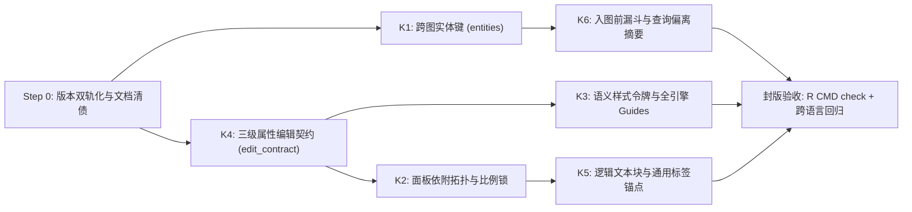

# gloss R 内核升级计划（Schema v1.2：硬事实锚点与语义图形场景底座）

> **目标基线**：在当前 `main`（包版本 `0.1.0` / Schema `1.1.0`）基础上，升级为 **包版本 `0.2.0` / Schema `1.2.0`**  
> **关联文档**：[`architecture.md`](architecture.md) · [`what-and-why.md`](what-and-why.md) · [`ecosystem-vision-and-contracts.md`](ecosystem-vision-and-contracts.md)

---

## 1. 升级背景与不可突破的架构红线

当前 `gloss` 内核（Schema v1.1）已经走通了“单次绘制捕获双 SVG、提取五类引擎中间表与比例尺、建立行级桥接与基础防走样锁”。但对照升级后的双核价值定位——**① 开放世界认知网络的硬事实锚点（跨图实体坐标系）** 与 **② 约束式智能呈现的语义图形底座（多面板重排与自动文字避让）**——现有内核仍停留在“单张扁平画面的幕后快照”，存在六处只有 R 编译现场才能补齐的底层断层。

本次内核升级严格遵守 [`AGENTS.md`](../AGENTS.md) 的五项铁律：

1. **公开 API 数量零膨胀**：`NAMESPACE` 严格保持现有 **8 个导出函数**不变（`gloss`、`gl_asset_map`、`gl_asset_bundle`、`gl_scene`、`gl_tables`、`gl_sources`、`gl_query`、`gl_register_engine`），仅在 `gloss()` 现有签名上补充向后兼容的可选参数（`entities = NULL`、`upstream = NULL`）。
2. **严守内核边界**：R 内核只负责提取**离开活体 R 会话与图形设备就无法无损还原的事实、拓扑与约束**；排版布局求解器、期刊主题渲染、外部文献/实验记录挂靠、跨图索引构建与 Agent 编排一律留在包外。
3. **单次绘制零重跑**：所有新增元数据均从同一次构建对象（如 `ggplot_built`、`gtable`、`HeatmapList`、冻结 display list）中提取，绝不二次执行用户绘图代码。
4. **纯增量向后兼容（Schema `1.1.0` → `1.2.0`）**：保留全部 v1.1 既有字段（如叶子级 `edit_policy` 字符串），新增结构化字段，确保现有 Python 校验与审计脚本平滑过渡。
5. **CRAN 零告警卫生标准**：第三方绘图包保留在 `Suggests`，零 `<<-`，零 `.GlobalEnv` 写入，`R CMD check --no-manual` 保持 `Status: OK`。

---

## 2. 阶段 0：协议版本解耦与仓库元数据清债（Step 0）

在动内核代码前，先消除当前仓库中“代码已是 Schema 1.1，但包元数据与部分文档仍停留在 0.1.0 / 1.0”的认知错位：

| 清债项 | 涉及文件 | 具体动作 |
| :--- | :--- | :--- |
| **包版本与协议版本显式双轨化** | `DESCRIPTION`, `R/utils.R` | `DESCRIPTION` 升至 `Version: 0.2.0`；`R/utils.R` 定义 `GLOSS_SCHEMA_VERSION <- "1.2.0"`，并在 `manifest.json` 与 `asset-map.json` 中同时记录 `package_version` 与 `schema_version`。 |
| **公开文档与文件树同步** | `README.md`, `NEWS.md`, `vignettes/gloss-quickstart.Rmd` | 补全 `scene/texts.json`、`assets/preview.png`、`tables/groups_*.json`、`gloss()` 参数表以及三元目录分工说明。 |
| **历史问题单归档整理** | `dev_docs/fragility-issues.md`, `dev_docs/closure-plan.md` | 将已完成项正文从“待修现状描述”改为“已验收实现记录”，避免阅读歧义。 |
| **架构地图探针同步** | `.project-map/build_map.R`, `.project-map/status.json` | 纳入包外全部脚本与新增测试统计，确保生成状态与 `HEAD` 一致。 |

---

## 3. 六大内核升级模块详解（Workstreams K1–K6）

### K1：跨图实体键系统（`entities` — Cross-Figure Entity Coordinate System）

#### 现状源码瓶颈
- `R/engine-ggplot.R`（`ggplot_infer_table_key`，第 550–560 行）仅硬编码匹配 `c("id", "sample_id", "patient_id", "label", "name")`，且强制要求**单列在整表内无重复值（`length(unique(vals)) == nrow(df)`）**。在纵向随访长表、多基因表达长表或分面汇总表中，同一个 `patient_id` 或 `gene_symbol` 出现多次，`key` 直接退化为空。
- `R/engine-heatmap.R`（第 180–198 行）仅把矩阵 `rownames` 存为 `row_label`，未将矩阵 `colnames`（通常是样本 ID 或细胞 Barcode）注册为列侧业务实体。
- 缺少用户显式声明业务实体语义（如区分“受试者”“样本”“基因”“批次”“时间点”）的通道，导致跨多张 `.gloss` 图拼接项目证据网时只能靠列名硬猜。

#### Schema v1.2 目标结构
在 `asset-map.json` 顶层新增 `entities` 数组，并在 `tables/schema.json` 列定义中增加 `entity_role`：

```json
"entities": [
  {
    "entity_role": "subject",
    "name": "patient_id",
    "bindings": [
      { "table_id": "raw", "axis": "row", "column": "patient_id", "unique": false }
    ],
    "n_distinct": 48,
    "domain_sha256": "sha256:...",
    "sample_values": ["P001", "P002", "P003"]
  },
  {
    "entity_role": "feature",
    "name": "gene_symbol",
    "bindings": [
      { "table_id": "matrix_ht1", "axis": "row", "column": "row_label", "unique": true }
    ],
    "n_distinct": 500,
    "domain_sha256": "sha256:...",
    "sample_values": ["EGFR", "KRAS", "TP53"]
  }
]
```

#### 实现方案与涉及文件
- **签名扩展（`R/capture.R`）**：`gloss(x, ..., entities = NULL)`，支持传入命名字符向量或列表（如 `entities = c(subject = "pat_id", batch = "seq_run")`）。
- **两级实体识别器（新增内部辅助于 `R/ir-lineage.R` 或 `R/utils.R`）**：
  1. 显式优先：按调用方传入的 `entities` 绑定对应表列；
  2. 启发式自动识别：放宽“全表唯一”限制，区分 `primary_key`（行唯一）与标准实体维度角色（`subject`、`sample`、`feature`/`gene`、`cell`、`batch`、`timepoint`、`treatment`/`group`、`region`），要求非空且为字符/因子/整型标识列；
  3. 引擎适配：在 `R/engine-heatmap.R` 中同时注册矩阵行名（默认角色 `feature` 或 `row_entity`）与矩阵列名（默认角色 `sample` 或 `col_entity`），并与注释表同名样本/基因对齐；在 `R/engine-patchwork.R` 中按 `(entity_role, name)` 跨子图归并 `bindings` 并计算去重后的 `domain_sha256`（排序去重值列表的哈希，支持跨图 `O(1)` 判断是否共享同一批样本）。
- **验收标准**：纵向重复测量长表、`patchwork` 双子图共享 `patient_id`、以及带样本列名与基因行名的 `ComplexHeatmap` 均能准确输出 `entities`，且两张共享同批病人的独立图生成的 `domain_sha256` 完全一致。

---

### K2：语义布局拓扑、组件依附关系与比例锁（`layout_graph` & `aspect_lock`）

#### 现状源码瓶颈
- **多面板重排断链**：`R/engine-ggplot.R`（第 1039–1147 行）将 `gtable` 布局拍扁为孤立的像素框 `bbox_pt`。外部智能呈现层在缩放面板或调整双栏间距时，不知道哪根坐标轴（`axis-b-1-2`）、哪个分面标题条（`strip-t-1`）挂在哪个 `panel_id` 的哪条边上。
- **`patchwork` 子图外围组件失联**：`R/engine-patchwork.R`（第 97–105 行）目前只将 `pgrob_names`（即 `panel-*` 内部叶子）筛入子图血缘，导致各子图自己的坐标轴刻度、轴标题、分面标签条和子图标题的 `panel_id` 全为 `NA`，甚至丢失了所属 `subplot` 编号。
- **纵横比约束缺失**：未区分自由伸缩笛卡尔面板与具有几何保真要求的定比面板（`coord_fixed()`、`CoordSf` 地理投影、等比例 PCA/UMAP、正方形格热图），一旦自适应改版拉伸单轴就会造成科学失真。

#### Schema v1.2 目标结构
1. **`ir.panels[]` 增补字段**：
   ```json
   {
     "panel_id": "p1_P1",
     "subplot": 1,
     "aspect_lock": 1.0,
     "resize_mode": "proportional_only"
   }
   ```
   （`aspect_lock`：自由比例为 `null`，`coord_fixed(ratio)` 或 `CoordSf` 记为具体高宽比数值；`resize_mode`: `"free_xy"` | `"proportional_only"` | `"fixed_pt"`）。
2. **`scene/leaves.json` 与 `lineage` 增补依附拓扑 `attached_to`**：
   ```json
   {
     "leaf_id": "L012",
     "semantic_role": "axis_tick",
     "subplot": 1,
     "attached_to": {
       "panel_ids": ["p1_P1"],
       "side": "bottom",
       "align_axis": "x"
     }
   }
   ```
3. **`scene.layout_tracks`（可选容器网格摘要）**：从 `gtable$layout` / `gtable$widths` / `gtable$heights` 提取行/列轨道类型（`fixed_pt` 装饰/文字轨 vs `flex_null` 弹性面板轨）与面板所在网格单元 `(t, l, b, r)`。

#### 实现方案与涉及文件
- **`R/engine-ggplot.R`**：
  - 从 `coord_obj` 检测 `CoordFixed`（提取 `ratio`）、`CoordSf` / `CoordPolar` / `CoordQuickmap`（标记 `proportional_only` 并记录渲染高宽比）；
  - 解析 `gtable$layout` 中 `axis-t/b/l/r-*`、`strip-t/b/l/r-*`、`xlab-*`、`ylab-*` 与 `panel-*` 所在 `(t, l, b, r)` 行列坐标的邻接关系，精确生成 `attached_to`。
- **`R/engine-patchwork.R`**：
  - 将子图叶子收集范围从“仅 `panel-*` grob”扩大到整个子图 `patchwork-table-*` 容器范围，使每个子图的坐标轴、分面条、标题全部带上准确的 `subplot` 编号与子图内 `attached_to` 关系。
- **`R/engine-heatmap.R`**：
  - 将顶部/底部列注释与列聚类树标记为 `attached_to: { panel_ids: [...], side: "top"|"bottom", align_axis: "x" }`，左侧/右侧行注释与行聚类树标记为 `side: "left"|"right", align_axis: "y"`。
- **验收标准**：`patchwork` 组合图中任意子图的 X/Y 轴叶子均能准确查到所属 `subplot` 与依附的 `panel_id`；`coord_fixed(ratio = 2)` 与 `geom_sf()` 面板准确输出 `aspect_lock` 与 `proportional_only`。

---

### K3：语义样式令牌与全引擎图例统一（`scale_id` · `style_tokens` · Heatmap `ir.guides`）

#### 现状源码瓶颈
- `elements.json` 仅记录最终渲染出的裸颜色（如 `#E64B35`），缺少显式 `scale_id` 引用。遇到半透明派生色（箱体填充、置信区间带）、多图例同色或参考线撞色时，表现层按 Hex 字符串替换极易漏改或误改。
- `R/engine-heatmap.R` 虽提取了 `ColorMapping` 到 `ir.scales`，但未提取 `ir.guides`，导致热图的色阶条与分组注释图例无法走统一的图例同步逻辑。

#### Schema v1.2 目标结构
- **`ir.scales[]`**：每个标度增加唯一稳定主键 `"scale_id"`（如 `"S1_colour"`、`"p2_S1_fill"`、`"ht1_main_fill"`）。
- **`ir.layers[]` 与 `ir.guides.entries[]`**：显式关联 `scale_refs`（如 `{"colour": "S1_colour", "fill": "S2_fill"}`）；图例项记录 `"scale_id"` 与 `"domain"`。
- **`elements.json`（可选轻量列 `color_token` / `fill_token`）**：对受离散或连续标度驱动的数据图元与图例色块，写入令牌标识（如 `"S1_colour::Cohort A"` 或 `"S2_fill::continuous"`），与装饰元素的静态常量颜色彻底区分。

#### 实现方案与涉及文件
- **`R/ir-lineage.R` & `R/engine-ggplot.R`**：在 `make_scale_ir()` 中生成确定性 `scale_id`；在 `ggplot_bridge_elements()` 中利用已配准的 `built_row_id` / `group_id` 回查对应离散分组值，写入 `color_token` / `fill_token`。
- **`R/engine-heatmap.R`**：解析 `ComplexHeatmap` 绘制生成的 `packLegend` / `color_mapping_legend` 视口与叶子，构建与 `ggplot` 结构完全一致的 `ir.guides`（含离散 `swatch_elements` 与连续色阶条 `bar_elements` / `tick_elements` / `label_elements`）。
- **验收标准**：带半透明 `geom_boxplot(alpha = 0.3)` + 实心 `geom_point()` + 同色手工 `geom_hline(colour = "#E64B35")` 的图表中，前两者携带 `S1_colour::<group>` 令牌，而参考线不携带分组令牌，下游换色零误伤；`ComplexHeatmap` 导出完整 `ir.guides`。

---

### K4：属性级三级安全编辑契约（`edit_contract` — Property-Level Safe Edit Contract）

#### 现状源码瓶颈
`R/ir-lineage.R`（第 331–420 行）仅提供叶子级三选一枚举 `edit_policy`（`geometry_locked` / `movable` / `style_only`），粒度过粗：
- 例如散点叶子标为 `geometry_locked` 后，无法在契约层表达“圆心 `(cx, cy)` 绝对锁死，但适配单栏缩印时允许统一微调点半径 `r`、线宽与透明度”；
- 坐标轴刻度文字标为 `geometry_locked` 后，无法表达“刻度数值文本与锚点不可篡改，但双栏拥挤时允许字号缩小或旋转 45°”；
- 更缺少对“截断轴范围、隐藏离群点、改变聚类顺序”这类**需要人类显式授权的科学边界操作（`gated`）**的规范定义。

#### Schema v1.2 目标结构
保留原 `edit_policy` 字段不破坏兼容，同时在 `asset-map.json -> scene.role_contracts`（角色默认契约表）及叶子特例覆写中定义三级属性契约：

```json
"role_contracts": {
  "data_mark": {
    "locked": ["data_position", "row_binding", "group_identity", "mark_count"],
    "editable": ["color_token_palette", "point_size", "stroke_width", "opacity"],
    "gated": ["subset_visibility", "axis_domain_clip", "stat_recompute"]
  },
  "axis_tick": {
    "locked": ["text_content", "tick_anchor_coord"],
    "editable": ["font_family", "font_size", "rotation", "color"],
    "gated": ["breaks_selection", "scale_transform"]
  },
  "data_label": {
    "locked": ["text_content", "target_row_binding"],
    "editable": ["label_offset", "text_wrap", "leader_line_path", "font_family", "font_size", "color"],
    "gated": ["label_text_override", "label_subset_filter"]
  }
}
```

#### 实现方案与涉及文件
- **`R/ir-lineage.R` & `R/package-assets.R`**：内置全部标准 `semantic_role` 的三级属性矩阵，并在 `asset-map.json` 中随包导出，使外部智能呈现层（`.gloss.view`）与几何校验器（`verify_svg_fidelity.py`）直接读取契约执行检查，无需硬编码猜规则。
- **验收标准**：所有内置引擎导出的 `semantic_role` 在 `role_contracts` 中 100% 有明确定义；校验器能够放行“刻度文字旋转 45°、散点半径统一缩至 1.5pt”，同时拦截“散点圆心偏移或刻度数字修改”。

---

### K5：逻辑文本块合并、精确字宽与通用数据标签锚点（`text_blocks` & `target_anchor_pt`）

#### 现状源码瓶颈
- **多行文本碎片化**：当标题、分面名或标签含有换行符 `\n` 时，`grid` 与 `svglite` 会在同一个叶子下输出多个独立的单行 `<text>` 节点。目前 `scene/texts.json` 逐行独立导出，外部排版器看到的是一堆互不隶属的单行碎片，无法做整体重换行（reflow）或整体对齐平移。
- **真实测量字宽未透出**：`R/capture.R`（第 1230 行）虽在内部读取了 `svglite` 的 `textLength` 计算包围盒，但未在 `texts.json` 暴露基线坐标 `(anchor_x, anchor_y)`、测量字宽 `measured_width_pt` 与行距线索。
- **非 `ggrepel` 标签缺目标锚点**：目前 `scene.label_links` 只为已画引线的 `ggrepel` 生成配对。普通 `geom_text` / `geom_label` / `BaseText` 标签在被智能排版器推开避让后，不知道它原本指代哪个精确数据点坐标，无法自动补画引线。

#### Schema v1.2 目标结构
升级 `scene/texts.json` 与 `scene.label_links`：
- `scene/texts.json` 每条记录新增：`text_block_id`（同一逻辑文本块共享 ID）、`line_index`、`block_text`（合并后的完整多行文本，记于首行或独立 `text_blocks` 摘要）、`anchor_pt: [x, y]`、`measured_width_pt`、`target_anchor_pt: [px, py]`（若为数据标签）。
- `scene.label_links` 统一扩展至所有数据标签图层：`{ "label_element_id": "E0042", "leader_element_id": null, "target_anchor_pt": [184.2, 96.5], "built_row_id": 12 }`（当原图无引线时 `leader_element_id` 为 `null`，允许呈现层在大幅移动标签后自动生成引线）。

#### 实现方案与涉及文件
- **`R/capture.R` & `R/package-assets.R`**：在 `parse_svg_elements()` / `build_texts_json_records()` 中记录 `<text>` 的原始 `(x, y)` 锚点与 `textLength`；按同一 `leaf_id` 内的文本排版分组（结合 `grob` 类型与水平对齐列）归并 `text_block_id`。
- **`R/engine-ggplot.R` & `R/engine-base.R`**：在桥接 `LABEL_GEOMS`（`GeomText`、`GeomLabel`、`GeomTextRepel`、`BaseText`）时，利用该行在 `built_table` 中的原始数据坐标 `(x, y)` 经 `panel_rendered_to_px()` 算出精确的目标数据点像素坐标 `target_anchor_pt`（注意：即使 `geom_text(nudge_y = 2)` 偏移了文字，目标锚点也能从未偏移的原始数据行或配对点图层还原）。
- **验收标准**：双行标题准确归入同一 `text_block_id`；未用 `ggrepel` 的普通 `geom_text` 数据标注同样具备精确的 `target_anchor_pt`。

---

### K6：入图前数据漏斗与 `gl_query()` 组内统计偏离直出（`upstream` & `context_summary`）

#### 现状源码瓶颈
- **入图前过滤盲区**：若分析脚本先执行 `cohort_full |> subset(arm == "B" & qc_pass) |> ggplot(...)`，`plot$data` 仅剩过滤后的子集。目前 `row_accounting` 只覆盖进入 `ggplot()` 之后的 `NA` 和越界裁剪，Agent 无法直接获知“总队列原本有多少人、在进图前筛掉了谁”。
- **探针缺少组内统计参照**：`R/query.R` 的 `gl_query()` 在框选 4 个异常点后仅返回那 4 行的原始数值，未直接给出“这 4 个点偏离所在分组均值/中位数多少倍 SD/IQR”，每次都需外围重复手写聚合逻辑。

#### Schema v1.2 目标结构
1. **`ir.data_funnel`（当传入 `upstream` 时生成）**：
   ```json
   "data_funnel": {
     "n_upstream": 150,
     "n_plot_input": 100,
     "n_upstream_excluded": 50,
     "entity_role": "subject",
     "entity_column": "patient_id",
     "excluded_entities_sample": ["P004", "P009"],
     "filter_hint": "subset(cohort_full, arm == 'B' & qc_pass)"
   }
   ```
2. **`gl_query()` 返回对象新增 `context_summary`**：
   对查询命中的行子集，按所属 `panel_id` 与离散分组列自动附上同组基准对照（`selected_n`、`group_n`、数值映射列的 `selected_mean`、`group_mean`、`group_sd`、`group_median`、`group_iqr`、`max_abs_z`、`max_iqr_multiple`）以及命中的去重 `entities` 列表。

#### 实现方案与涉及文件
- **`R/capture.R` & `R/sources.R`**：`gloss(x, ..., upstream = NULL)` 支持传入上游母表 `data.frame`（或列表 `list(data = df_all, note = "...")`），不强制把整张百万行母表冗余打包进 `tables/`（可通过 `select` 控制是否导出母表），但自动比对实体键生成紧凑的 `ir.data_funnel`。
- **`R/query.R`**：新增纯内存轻量统计对比函数 `compute_query_context_summary()`，零外部依赖完成选中样本与同面板/同分组全量样本的对比计算，并同步升级 `skills/gloss/scripts/focus_bridge.py` 的 `box-to-rows` 输出探针。
- **验收标准**：传入 `upstream = full_df` 时准确记录进图前排除人数与实体 ID；对散点图右上角异常点调用 `gl_query(cap, box = ...)` 直接返回对应的实体 ID 列表与组内 `z-score` / `IQR` 偏离倍数。

---

## 4. 模块依赖关系与实施排期



### 建议分四个批次推进（每批次独立可测、保持主干全绿）

1. **Batch 1 — 协议基座与实体/漏斗层（Step 0 + K1 + K6）**
   - 改动集中于 `DESCRIPTION`、`R/utils.R`、`R/capture.R`、`R/query.R` 及各引擎表提取处；
   - 率先打通“视觉框选 → 精确实体 ID + 组内偏离度 + 完整过滤漏斗”的硬核探针能力。
2. **Batch 2 — 样式令牌与三级安全编辑契约（K4 + K3）**
   - 改动集中于 `R/ir-lineage.R`、`R/engine-ggplot.R`、`R/engine-heatmap.R`；
   - 补齐 `scale_id`、颜色令牌与 `ComplexHeatmap` 的 `ir.guides`，锁定属性级安全编辑边界。
3. **Batch 3 — 语义布局拓扑与文本排版基座（K2 + K5）**
   - 改动集中于 `R/capture.R`、`R/engine-ggplot.R`、`R/engine-patchwork.R`、`R/engine-heatmap.R`；
   - 修复 `patchwork` 子图外围组件归属，输出 `attached_to`、`aspect_lock`、`text_block_id` 与通用 `target_anchor_pt`。
4. **Batch 4 — 全量验证与契约冻结**
   - 新增 `tests/testthat/test-v12-kernel.R` 专项测试集；
   - 同步升级包外 `verify_svg_fidelity.py` 与 `focus_bridge.py` 消费新字段；
   - 通过全量 `devtools::test()`、Python 端到端工作流测试与 `R CMD check --no-manual`（零 ERROR / WARNING / NOTE）。
