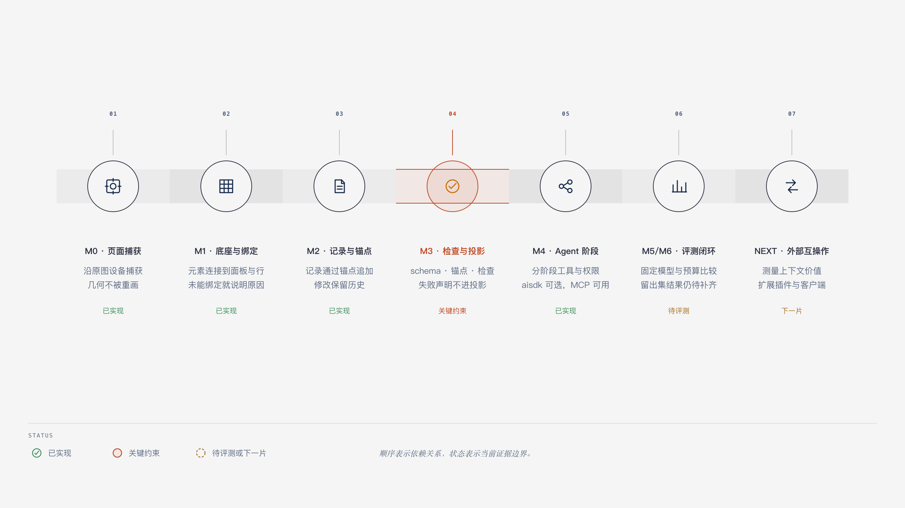
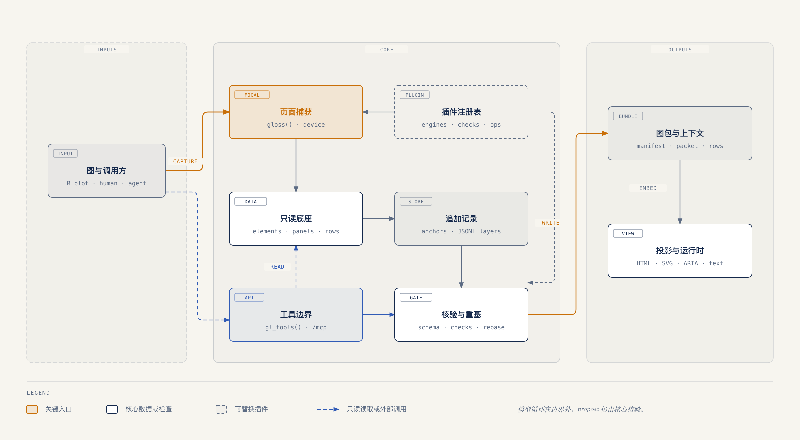

# gloss 技术路线与架构设计

这份说明把 `gloss` 当前已经落地的能力、仍待评测的边界和下一片工作放到同一条路线里。内容依据 `dev_docs/design.qmd`、当前计划、开发日志和代码入口整理，证据截至 2026-11-22。

## 技术路线

可直接打开的版本见 [HTML 图](figures/diagram-design/gloss-technical-route.html)，矢量版本见 [SVG 图](figures/diagram-design/gloss-technical-route.svg)。

| 阶段 | 主要入口 | 交付物 | 当前状态 |
| --- | --- | --- | --- |
| M0 页面捕获 | [`gloss()`](../R/core-substrate.R) 与 [`R/engine-*.R`](../R) | 原图设备产生的页面、元素归属、viewport、面板和几何 | 已实现。开发集和留出集都有捕获保真度记录，计数不符和设备不支持时拒绝绑定 |
| M1 底座与绑定 | [`gl_classify()`](../R/classify.R)、[`gl_tree()`](../R/hierarchy.R)、[`gl_bindings()`](../R/core-bind.R) | 结构角色、结构树、数据树、元素到构建行的带状态绑定 | 已实现。确定性角色规则覆盖已测元素，绑定区分 `verified`、`ambiguous`、`unbound` 和 `count_mismatch` |
| M2 记录与锚点 | [`gl_record()`](../R/core-record.R)、[`gl_rebase()`](../R/core-update.R) | 八个核心层、append-only JSONL 日志、多选择器锚点、冲突和失效传播 | 已实现。图改动后唯一锚点继续有效，丢失或不唯一的目标显式进入修复路径 |
| M3 检查与投影 | [`gl_check()`](../R/semantic-checks.R)、[`gl_apply()`](../R/operations.R)、[`gl_export()`](../R/project-accessibility.R) | 六个检查原语、R 端操作、HTML 运行时、ARIA、文本和 Web Annotation 投影 | 已实现。检查失败的声明不能作为事实投影，叠加内容进入独立的 overlay 组 |
| M4 Agent 阶段 | [`gl_tools()`](../R/agent-tools.R)、[`gl_annotate()`](../R/agent-runner.R) | 分阶段读写权限、四级披露、提示词版本、缓存重放和提交前校验 | 已实现。`aisdk` 只作为可选兼容运行器，核心不持有模型循环 |
| M5/M6 评测闭环 | `bench/`、`dev_logs/`、遮蔽绑定和声明核验实验 | 同模型、同预算、同原始材料下的决定性比较，覆盖率、误拒率、证据召回和无依据断言率 | 部分完成。确定性 fixture、更新实验和小规模开发矩阵已完成，完整留出集、人工开放世界审计和多次重复仍待补齐 |
| 下一片 外部互操作 | [`gl_context_plan()`](../R/context-assembly.R)、[`gl_context_assemble()`](../R/context-assembly.R)、[`gl_mcp_serve()`](../R/mcp-interface.R) | 任务化上下文包、MCP 工具面、跨客户端读取轨迹和上下文价值比较 | 机制已实现，证据仍待补齐。已有本地注入传输 smoke，真实 HTTP、stdio、SSE 和上下文价值实验仍开放 |

这条路线的依赖关系可以压缩成一条主链。原图设备先给出不可替代的几何事实，底座把事实组织成元素、面板和数据行，记录层把人和 agent 的语义追加到锚点上，检查把可计算声明变成带证据的状态，投影和上下文装配再把当前快照交给浏览器、文档和外部 agent。

有两条反馈回路贯穿主链。

- 底座变化后，锚点、记录依赖和检查结果全部重跑，失效项单独进入修复。
- 评测结果只改变计划、阈值和证据边界，不回写成领域事实，也不通过放宽测试来追赶预期数字。

## 架构设计

可直接打开的版本见 [HTML 图](figures/diagram-design/gloss-architecture.html)，矢量版本见 [SVG 图](figures/diagram-design/gloss-architecture.svg)。

### 核心边界

`gloss` 的核心只承担五件事。

1. 生成和读取只读底座。
2. 解析锚点并维护记录状态。
3. 在构建后的数据上执行检查。
4. 保存追加日志、差异和重基结果。
5. 管理插件注册表和版本信息。

引擎、分类规则、层、检查原语、操作、投影、上下文嗅探和 agent 阶段都通过 `gl_register()` 注册，内置实现和第三方扩展走同一条路径。图包的 manifest 记录所用插件及其版本，缺插件时仍可恢复图包，并把受影响记录标成缺失状态。

### 数据平面

数据平面从左到右保持原图语义。

- `gloss()` 让输入自己在图形设备上画出页面，再以组和探针取得叶子 grob、viewport、面板和实际图元的归属。
- substrate 只读保存元素、几何、面板比例尺、原始表、构建表、引擎专有表和绑定状态。
- 记录层通过数据键、谓词、结构路径、角色、区域和元素 id 等选择器指向 substrate，不把语义塞回 SVG 几何。

### 控制平面

控制平面把人、R 程序和 agent 统一到工具边界。

- `gl_tools()` 和 MCP 暴露只读查询、上下文装配、检查、锚点解析和提议入口。
- 唯一写入口是 `propose` 或等价的检查过的提交路径。
- 提交依次经过 schema 校验、锚点解析和声明核验，失败结果保留为拒绝或失效状态，不能进入事实投影。
- 模型、记忆、路由、权限和重试由外部 agent 客户端负责，`gloss` 不拥有 agent loop。

### 存储与投影

图包有目录和单文件两种形式。目录适合版本控制，单文件适合分享和恢复。单文件投影内嵌恢复所需的 bundle 和上下文摘要，`gl_read()` 可以从中继续追加记录、重新核验和重新投影。

投影层从底座和记录快照生成 HTML、SVG、ARIA 树、纯文本、Web Annotation 和 Workbench。浏览器运行时只执行已声明的操作，叠加元素由底座根据锚点几何生成，模型输出不能写入 SVG、CSS、HTML 或 JavaScript。

### 关键架构约束

- 几何只来自原始图形设备，无法正确归属或绑定时拒绝并说明原因。
- 语义与图分开，记录只追加，修订、撤回、核验和冲突裁决都留下事件。
- 失败检查是硬约束，不能依靠更高的披露级别或更强的模型绕过。
- 默认披露只给结构和摘要，按任务再读取行、上下文切片和检查证据。
- 上下文计划和上下文包都是确定性的中间层，记录焦点、证据、遗漏和后续读取，不把自然语言猜测写进图包。

## 下一片的验收口径

下一步应冻结开发集中的问题、模型、预算、最大工具调用数和披露级别，然后比较三种输入条件。原始材料、固定摘要包和任务化装配包都要记录包大小、token、调用次数、时长、证据召回率、证据精确率、焦点错误率和无依据断言率。留出集只在预测提交后运行，外部客户端还要补上真实 Streamable HTTP、legacy SSE 和 stdio 的互操作记录。
